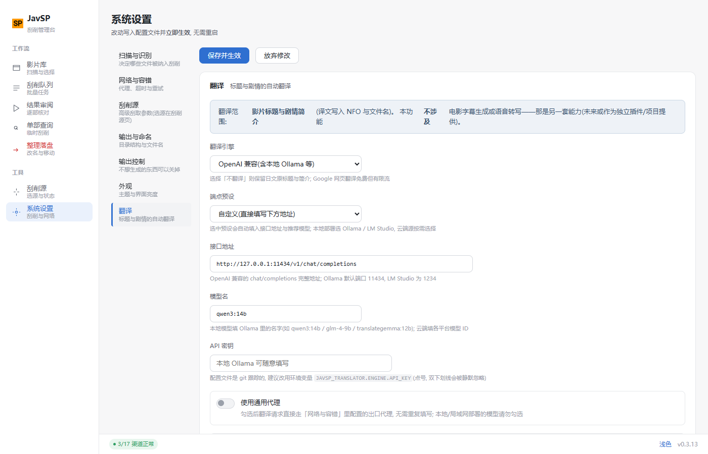

> Language / 语言: **English** | [简体中文](README.md)

# JavSP-fork (AV metadata scraper with WebUI)

**An AV metadata scraper that aggregates data from multiple sites, with a Web UI**

> **This project is a fork of [Yuukiy/JavSP](https://github.com/Yuukiy/JavSP).** The original is an excellent command-line scraper, but it has **stopped receiving updates since February 2025** (numerous issues and PRs went unhandled, and several sites broke after redesigns with no one fixing them). This fork keeps its crawler and metadata engine intact, and adds the community's most-requested **graphical interface**, while continuing to track site changes — see **[Relationship with the Original Project](#relationship-with-the-original-project)** for the detailed diff.

This project is derived from [Yuukiy/JavSP](https://github.com/Yuukiy/JavSP). The original is a CLI tool; on top of its mature crawler and metadata engine, this fork **adds a Web UI and a desktop app**: open a browser (or a desktop window) to scan your movie folders, scrape metadata, preview information, and organize them into your library (generating the NFOs and cover art that Emby / Jellyfin / Kodi expect).

The code is **fully open source** (GPL-3.0). Both the Docker image and the Windows exe ship with local build scripts so you can audit and package them yourself.


## Features

- Automatically identify movie IDs and handle multi-part movies
- Aggregate data from multiple sites into an NFO, scrape in parallel with multiple threads, download HD cover art
- Translate titles and plot summaries
- **Web UI**: folder scanning, single-movie scraping, batch tasks (with optional organizing), metadata preview, one-click organize
- **Per-site data passthrough**: results show which site contributed which field, making it easy to judge data quality and spot a single broken source
- **Channel health monitoring & automatic circuit breaking**: dead sources are automatically dropped from scraping — no more waiting on them
- **Web-based configuration**: the Settings page edits and writes back `config.yml` via grouped forms; changes apply instantly and Chinese comments are preserved
- **Output items can be toggled individually**: cover poster / fanart / extra fanarts / NFO each have their own switch (turn them all off when letting Jellyfin scrape by itself for a faster organize)
- **Optional AI cover cropping**: local `slimeface` face detection, and you can verify whether it actually took effect (applied / fell back / why it fell back is reported honestly)
- **Multiple delivery forms**: Web service (Docker / NAS) + Windows desktop app (exe, default native GUI window shell / `--nogui` for browser)
- **Optional single-user login**: set `JAVSP_AUTH_PASSWORD` to enable it; unset means no login required (default)

Built-in **19 scraping sources** (`javsp/web/*`, toggleable on the Settings page): airav, avsox, avwiki, dl_getchu, fanza, fc2, fc2ppvdb, gyutto, jav321, javbus, javdatabase, javdb, javdbapi, javfree, javlib, javmenu, mgstage, njav, prestige. Among them `javdbapi` / `javdatabase` / `javmenu` / `javfree` / `gyutto` / `njav` are ported/enhanced by this fork.

## Architecture

```
              ┌──────────────────────────────────────────────┐
              │         Frontend assets frontend/dist         │
              │      Vue3 + Vite · custom design system        │
              │            (no UI framework)                   │
              └───────────────────────┬──────────────────────┘
                                      │ shared by both forms
        ┌─────────────────────────────┴─────────────────────────────┐
        │                                                           │
┌───────┴────────┐                                    ┌─────────────┴───────┐
│ ① Docker / NAS  │                                    │ ② Windows desktop exe │
│ docker/Dockerfile│                                   │ PyInstaller onedir   │
│ multi-stage img  │                                    │ JavSP.exe shell      │
│ uvicorn in cont. │                                    │ default pywebview    │
└───────┬────────┘                                    └─────────────┬───────┘
        │          Same FastAPI backend (server.py:entry)           │
        └──────────────────────────┬─────────────────────────────────┘
                                   ▼
        ┌──────────────────────────────────────────────┐
        │  FastAPI backend javsp/server.py              │◀── HTTP/SSE ──▶ browser
        │  auth.py · Web-config writeback & hot reload   │
        └──────────────────────┬───────────────────────┘
                               │ calls
        ┌──────────────────────┴───────────────────────┐
        │  Core orchestration javsp/core.py             │ shared by CLI/Web/desktop
        │  scrape_movie() / organize_movie() / ...      │
        └──────────────────────┬───────────────────────┘
                               │
        ┌──────────────────────┴───────────────────────┐
        │  Crawler layer javsp/web/*                    │ 19 sources + health.py breaker
        │  ID → MovieInfo                               │
        └──────────────────────────────────────────────┘
```

Release dual assets: javsp-fork-<ver>-image.tar.gz (ready to `docker load`)
              ＋ JavSP-<ver>-windows.zip (extract and run)

- **Crawler layer `javsp/web/*`**: ID → `MovieInfo`, the upstream logic base + fork port enhancements — the most stable foundation.
- **Core layer `javsp/core.py`**: orchestration extracted from the CLI, with progress callbacks, exposing `scrape_movie()` / `organize_movie()` / `scan_library()`, shared by CLI and Web.
- **Backend `javsp/server.py`**: FastAPI + SSE, main endpoints:
  | Endpoint | Description |
  |---|---|
  | `GET /api/health` | Health check, also returns the server version |
  | `POST /api/scan` | Scan a movie folder, return the list and assign `guid` |
  | `GET /api/movies` | List in-memory movie tasks |
  | `POST /api/scrape` | Scrape a single movie, SSE pushes each crawler's progress |
  | `POST /api/organize` | Organize a single movie (NFO + cover + rename), SSE pushes progress |
  | `POST /api/batch` | **Batch** scrape (optional organize), SSE pushes per-movie + overall progress |
  | `GET` / `PUT /api/config` | Read / write back `config.yml` (applies instantly, no restart) |
  | `GET /api/config/runtime` | View the actually-effective runtime config (incl. per-crawler proxy / timeout) |
- **Frontend `frontend/`**: Vue3 + Vite, custom design system (Element Plus removed since 0.2.x, hand-written components + design-token CSS), with scanning, single scrape, batch tasks, channel monitoring, settings pages.
- **Channel health `javsp/web/health.py`**: background probing + circuit break / half-open recovery, see below.
- **Auth `javsp/auth.py`**: optional single-user login, session on disk, login lockout.

## Quick Start

### Method 1: Docker / NAS (recommended, best fit for a media stack)

```bash
# Dockerfile lives in the docker/ subdir, must use -f
docker build -f docker/Dockerfile -t javsp-fork .
docker run -d -p 8000:8000 -v /your/media:/data javsp-fork
# open http://<host>:8000 in a browser
```

- **Scraping a NAS share**: the app places no restriction on scan directories. Bind-mount the NAS's real share into the container (recommend unifying as `/data`); in the UI just fill in the **in-container mount path** to scrape, rename, and generate NFO / cover directly — no code changes. The scan box has a "Browse directory…" button for step-by-step selection (directories only); the image pre-sets `JAVSP_BROWSE_ROOT=/data` to constrain the browsable scope.
- **⚠️ Config persistence (mandatory)**: `config.yml` controls proxy, sources, naming rules, and scan directories. Without persistence, **all settings are silently lost** on container rebuild/upgrade. In compose you must both mount the config dir and tell the app:
  ```yaml
  volumes:
    - /share/javsp_config:/etc/javsp        # ① mount the config dir
  command: ["-c", "/etc/javsp/config.yml"]   # ② tell the app to read this file
  ```
  On first deploy, create the dir and drop in the default config (`docker run --rm ... cp /app/config.yml /etc/javsp/config.yml`). After init, it's recommended to configure the network proxy in Settings first and confirm the save hint "written to config.yml … applied instantly" before scraping.
- **Network proxy**: all sites go through the global `network.proxy_server` proxy (`proxy_free` per-site bypass list has been removed); if the egress is blocked, switch proxy nodes. If the proxy does TLS interception (MITM), the default verification will throw `SSLCertVerificationError`. This project **does not disable verification by default**; instead it supports mounting the proxy root CA: set `JAVSP_CA_BUNDLE=/certs/proxy-ca.crt` and mount that cert (verification stays on).
- **Troubleshooting "only some sites return data"**: usually not a fault. Run the crawler directly inside the container to see the real error: `MovieNotFoundError` = that site doesn't carry this ID (normal); `403` = needs login / anti-bot; `SSLCertVerificationError` = MITM proxy missing CA; `Fail to connect` = egress unreachable or IP blocked.
- The container runs as root by default; written files are owned by root (Jellyfin/Emby read-only is usually fine; use `--user 1000:1000` to align when write-back is needed). Files smaller than `scanner.minimum_size` (default 232MiB) are not scanned.

### Method 2: Local dev run (Web service)

```bash
pip install -e .                                  # install deps
cd frontend && npm install && npm run build && cd ..   # build frontend
javsp server                                      # or python -m javsp server
# open http://127.0.0.1:8000 in a browser
```

### Method 3: Desktop app (Windows native exe, ready to use)

Download `JavSP-<version>-windows.zip` from Releases, extract anywhere, and **double-click `JavSP.exe`**: it opens a native window loading the WebUI by default (pywebview); add `--nogui` to use a browser instead. All config/sessions land in the **exe's own directory** (portable, doesn't touch the system drive); since 0.3.2 the config file is `config.yml` next to the exe, so a full-package upgrade won't overwrite your config.

> **Windows 10 note**: the default GUI shell relies on the **Microsoft Edge WebView2 Runtime**. Win11 ships with it; **Win10 does not necessarily** (it is absent on machines where Edge was removed, has not been updated for a long time, or is blocked by enterprise policy). When it is missing, older versions fall back to the IE engine, while our frontend is a modern Vue3 bundle — the symptom is a **blank window after double-click**.
>
> Pick either fix:
> 1. Install the WebView2 Runtime (~130 MB, one-off): https://developer.microsoft.com/microsoft-edge/webview2/ — then double-click again;
> 2. Or use browser mode: run `JavSP.exe --nogui` to keep the service in the background and open `http://127.0.0.1:8000` in **Chrome / Edge** (identical to the window mode).
>
> Since **v0.3.11** the app pre-checks WebView2 and .NET Framework before opening the window; when something is missing it **pops up a clear explanation and automatically falls back to browser mode**, so no more "nothing happens / blank window". Renderer logs are written to `JavSP.log` next to the exe for troubleshooting.

Build it yourself (run in a Python 3.10~3.12 environment with project deps installed):

```bash
python tools/build_desktop.py          # one shot: frontend build → PyInstaller package → zip
# verify desktop logic only (no packaging):
python -m javsp.desktop                # default GUI window
python -m javsp.desktop --nogui        # open WebUI in browser
```

### Original CLI (still available)

```bash
javsp -h        # original CLI args (logic moved to core, behavior unchanged)
```

## Usage

1. **Scan**: on the Scan page, enter the movie folder to list pending movies.
2. **Scrape**: enter an ID for a single movie to scrape and preview; batch can launch a task and show live progress (SSE). Results show **per-site contribution**, making it easy to judge data quality and spot a single broken source.
3. **Organize**: after preview confirmation, one click generates NFO, downloads covers, and renames/organizes into the media library folder (default move to `#整理完成/{actress}/...`, can be disabled).
4. **Configure**: on the Settings page, adjust sources, proxy, retry/timeout, naming rules, output switches, etc. Saving uses **change-only field writeback** so Chinese comments and formatting are preserved; after saving it **applies instantly with no restart** (reloads runtime config and refreshes each crawler's network egress), and a bad config auto-rolls-back.

For more detailed source notes, see the original project's [JavSP Wiki](https://github.com/Yuukiy/JavSP/wiki); but **use this project's Settings-page builder as the source of truth for naming-rule variables** (the syntax differs from upstream — see [migration notes](#migrating-from-the-original-project)).

### Output control: turn off what you don't want

When you let Jellyfin / Emby do the scraping themselves, downloading HD covers, cropping posters, grabbing stills, and writing NFOs is redundant work. The Settings page lets you disable them one by one:

| Switch | Controls | After disabling |
|---|---|---|
| `cover.enabled` | portrait poster | no cropping, no poster generated |
| `fanart.enabled` | landscape fanart | still downloads cover for poster cropping, deletes the original after |
| `extra_fanarts.enabled` | stills/backdrops | not grabbed at all (the most time-consuming item) |
| `nfo.enabled` | NFO file | no NFO written at all |

Poster and fanart share the same source; with both off, even cover download won't happen, noticeably speeding up batch organize.

### Channel monitoring & circuit breaking: stop waiting on dead sources

Under a restricted egress, sites fail one after another. This project's "Channel monitoring" page tells you **which sources are actually usable right now**, and **automatically drops dead sources from scraping**.

| Mechanism | Behavior |
|---|---|
| Judgment standard | runs the real `parse_data` and requires a valid title (many dead sites return 200 + a shell page; checking only the transport layer misjudges) |
| Trip threshold | trips after 2 consecutive failures (a single failure is usually just network jitter, avoids killing good sources) |
| After trip | scraping skips that source, no more requests; skipped sources still show in results marked "skipped" |
| Auto recovery | cooldown 10s → 20s → 40s … (cap 5 min), then half-open probe: recovers on success, re-trips on failure |
| No trip | ID not indexed, parse exception, or duplicate result — means the source itself is fine |
| Detection | background auto-probe every 5 min (can disable/manual), and every scrape success/failure also feeds the health profile (zero extra requests) |

Each row shows: status, whether it participates in scraping, latency, recent hit rate, site domain, failure reason, remaining cooldown. CLI and Web share the same criteria.

### Integrating NFO with Jellyfin / Kodi

After organizing, each movie lands in its **own folder** (`output_folder_pattern` defaults to `#整理完成/{actress}/[{num}] {title}`); the NFO default name is `movie.nfo`, which falls right inside Jellyfin's lookup rule (movies in non-mixed folders read `movie.nfo` in that dir).

> **Easily-overlooked prerequisite**: Jellyfin must enable local metadata reading in the library to recognize NFOs (in "Manage Library" add **Nfo** to "Local metadata reading order"). When missing, it fails silently — the whole NFO is just ignored.

When writing NFO, ratings are normalized to 0~10 (Jellyfin parses `<rating>` with a single float conversion and no range check, so out-of-range values display as-is).

### Translation Engine: auto-translate titles and plot summaries

During organizing, Japanese titles and plot summaries can be translated into Chinese (written into NFO and filenames), configured in "System Settings → Translation".

**Scope**: only **movie titles and plot summaries** — no subtitle generation or speech transcription (a separate capability, possibly a standalone plugin/project in the future).

> **Don't need translation?** Skip this whole section: translation is off by default (`engine: null`) and does not affect the scraping/organizing workflow — turn it on whenever you need it.

**Review before writing to disk**: with translation configured, batch-scrape (without "and organize") in the Scrape Queue, then the Result Review page shows the **original → translated** comparison for each movie's title and plot, with "use this translation when organizing" checked by default — organize only after you're satisfied; turn the switch off for any single movie to keep its original text in the NFO. Choosing "Scrape & organize" directly writes the default translation to disk without review.

**Target language**: Simplified Chinese / Traditional Chinese / English / Japanese / French / German / Spanish are selectable; the translation strictly follows the chosen language — no mixed Traditional/Simplified characters or stray text from other languages.

**Consistent Chinese characters throughout the NFO**: Besides the translated title/plot, genre tags come from the source sites' original labels (some sites serve Traditional Chinese, some Japanese). When writing the NFO, characters are normalized to the target language — choosing Simplified Chinese converts Traditional labels too (e.g. `單體作品` → `单体作品`, `DMM獨家` → `DMM独家`), and vice versa; non-Chinese target languages are left untouched. Tags marked as "not written" in the mapping table (e.g. distributor-exclusive tags) are unaffected.

**Same language = no translation**: If the source text is already in the target language (e.g. a site title already in Chinese with Simplified Chinese selected), translation is skipped and the original text is used as-is — saving time (a plot takes several seconds even on a local model) and avoiding pointless rewrites. A Traditional source with a Simplified target is also skipped; consistency is guaranteed by the character normalization above.

**Design decision: custom interface only — no LLM is bundled into this project.** Bundling a model/inference framework would bloat the software quickly (model files, dependencies, GPU/CPU adaptation are all bottomless pits), and users' hardware and network conditions vary widely. So this project only provides a **standard OpenAI-compatible endpoint**: URL, model name and API key are all filled in by the user — self-hosted (Ollama / LM Studio) or cloud sources both work, deployment form is entirely up to you. This capability is inherited from upstream Yuukiy/JavSP (which only had the OpenAI engine with no custom entry), and was expanded in response to [issue #5](https://github.com/luckwalter/JavSP-fork/issues/5) "Can the translation engine add Ollama?".

**Self-hosted (recommended: free / uncensored / unlimited)**: run [Ollama](https://ollama.com/) locally or on your LAN, then pick the "Local Ollama" or "LAN Ollama" preset to auto-fill the endpoint and a recommended model (`qwen3:14b` / `glm-4-9b` / `translategemma:12b` for translation; `qwen3:8b` on limited hardware; below 8B quality is close to auto subtitle translation — not recommended). ⚠️ **For adult content, cloud APIs are generally unusable**: OpenAI / Anthropic / Google ToS prohibit adult content, and domestic platforms (SiliconFlow / ModelScope / Z.ai / Kimi) are safety-aligned and will refuse — a local model is the only reliable path.

**Quick Ollama setup** (modeled on the author's LAN deployment; works on Windows / Linux / macOS):

1. **Install Ollama**: download from [ollama.com](https://ollama.com/); on Linux you can also run `curl -fsSL https://ollama.com/install.sh | sh`
2. **Allow LAN access** (required when accessing from another machine): set the environment variable `OLLAMA_HOST=0.0.0.0` and restart Ollama (on Windows, add it under System Properties → Advanced → Environment Variables, then restart Ollama); also make sure the machine's firewall allows port 11434
3. **Pull a model**: `ollama pull translategemma:4b` (~3.3GB, Google's translation-specialized fine-tune, 55 languages; general-purpose alternatives: `qwen3:14b` / `glm-4:9b`, or `qwen3:8b` on tight hardware)
4. **Configure in JavSP**: "System Settings → Translation" → engine "OpenAI-compatible (incl. local Ollama)" → endpoint preset "LAN Ollama" → change the URL to `http://<IP of the Ollama machine>:11434/v1/chat/completions` → model name `translategemma:4b` → keep "use global proxy" off → target language "Simplified Chinese" → save (takes effect immediately)
5. **Verify**: scrape a few movies in the Scrape Queue (leave "and organize" unchecked) → open Result Review to check the translations → then "Go organize"

**Field-tested case** (author's LAN during v0.3.14 development): a Windows machine running Ollama + `translategemma:4b` — Google's translation-specialized fine-tune of Gemma 3 (~3.3GB, Q4_K_M, 55 languages). In JavSP set the endpoint to `http://192.168.1.100:11434/v1/chat/completions`, model `translategemma:4b`, and leave "use global proxy" off (direct LAN access). Tested JA→ZH title/plot translations came out accurate and fluent — **the 4B class is enough for metadata**; a plot paragraph takes a few seconds even on CPU. Pick `translategemma:12b/27b` for higher quality. ⚠️ Ollama listens on `127.0.0.1` by default: for LAN access set the env var `OLLAMA_HOST=0.0.0.0` and restart Ollama (and make sure port 11434 is allowed through the machine's firewall).

**Config example (local Ollama, copy-paste ready)**:

```yaml
translator:
  fields:
    title: true      # translate titles
    plot: true       # translate plot summaries
  engine:
    name: openai
    url: 'http://127.0.0.1:11434/v1/chat/completions'   # local Ollama; for a LAN machine use http://<IP>:11434/v1/chat/completions
    api_key: 'ollama'                                    # local models don't check the key; any non-empty value works
    model: 'translategemma:4b'                           # or qwen3:14b / glm-4:9b, etc.
    use_proxy: false                                     # no proxy for local deployment
```

Or use the WebUI (Settings → Translation: engine "OpenAI-compatible (incl. local Ollama)", preset "Local Ollama" auto-fills the endpoint and recommended model; saving applies instantly):



**Cloud free-tier assessment** (compiled as of 2026-10; quotas change — check each provider's console):

| Provider | Free quota (approx.) | Direct from CN | Adult content | Notes |
|---|---|---|---|---|
| Groq | 30 RPM / 1000 RPD / 200K tokens per day | needs proxy | ⚠️ ToS gray area, model may refuse | very fast, no card |
| OpenRouter | 20 RPM / 50 RPD (1000 RPD after $10 top-up) | needs proxy | ⚠️ model-dependent, free pool rotates | one key, many open models |
| Gemini (AI Studio) | Flash 15 RPM / 1500 RPD | needs proxy | ❌ safety filters on by default | free-tier data used for training |
| SiliconFlow | 1000 RPM / 50K TPM | ✅ | ❌ safety-aligned, refuses | lowest latency in CN |
| ModelScope | 2000 RPD | ✅ | ❌ same | Alibaba official |
| Local Ollama | unlimited | ✅ | ✅ uncensored | uses local RAM/CPU, speed varies |

For non-local cloud sources, enable "Use general proxy" to reuse the egress proxy configured under "Network & Retry" — no need to enter it twice.

## Security Notes (read before deploying)

- This is a **single-user, personal tool**; use only on a trusted network (local / home LAN) is recommended — **putting it on the public internet is an explicitly unsupported use**.
- **Optional single-user login**: set `JAVSP_AUTH_PASSWORD` to enable login (session on disk, with login lockout); **unset means all endpoints are login-free (default)**. Once enabled, it blocks anyone who can reach the port from scanning directories, moving/renaming media, or rewriting `config.yml`.
- `javsp server` **listens on `127.0.0.1` by default** (local only); do not change `JAVSP_HOST=0.0.0.0` on an untrusted network.
- **Docker deployment listens on all interfaces by default** (needed for external access). With Docker, write `ports` as `127.0.0.1:8000:8000` (local only) rather than `8000:8000` (exposes to the whole LAN); if LAN access is truly needed, confirm the network is trusted and put a reverse proxy + auth in front.
- The accessed hostname must be in the `JAVSP_ALLOWED_HOSTS` allowlist (default allows only `127.0.0.1`/`localhost`; container deploy relaxes this) to block **DNS Rebinding** attacks.
- "Browse directory…" lists directories only (not files) and is confined within `JAVSP_BROWSE_ROOT` (after `realpath` resolves `..`); unset means `/`, the image pre-sets `/data`, recommend narrowing the scope.
- After moving movies, an **emptied source directory is deleted** and recursively cleans leftover empty dirs upward (max 2 levels); NAS thumbnail cache dirs don't count as content; guardrails: never delete the scan root, user home, CWD, other hidden dirs, or valid non-empty dirs — any step error stops immediately.
- In the config returned by `GET /api/config`, sensitive fields like translation keys are **masked**; the frontend restores them on save, so keys aren't lost.
- `config.yml` is git-tracked; after filling `api_key` do not `git commit -a`; prefer overriding via env vars (e.g., `JAVSP_TRANSLATOR.ENGINE.API_KEY=xxx`, higher priority than the config file). ⚠️ **Nested levels must use dot `.`, not double underscore `__`** (writing `JAVSP_TRANSLATOR__ENGINE__API_KEY` is silently ignored).

## Versioning

This project **does not follow the upstream version numbers**, starting from `0.0.1`: small changes (fix/tweak) bump the third digit; large changes (feature/architecture) bump the second digit and reset the third to 1; stable release `1.0.0`. **Current version: 0.3.16**.

The version number's single source of truth is `pyproject.toml`; `python sync_version.py` syncs it to `frontend/package.json` / `package-lock.json` / `README.md`, and `python sync_version.py --check` validates consistency (both the version badge and the "current version" marker in README will error if either is missing or changed in form, never silently passing); for cross-environment deploys (e.g., NAS container) also use `python sync_version.py --check-target <path>` to validate the target's `pyproject.toml`. Full changelog: **[CHANGELOG_FORK.md](./CHANGELOG_FORK.md)** (maintained independently by this fork, does not overwrite upstream `CHANGELOG.md`).

## Relationship with the Original Project

This fork derives from [Yuukiy/JavSP](https://github.com/Yuukiy/JavSP); **the crawler layer and metadata logic are taken entirely from upstream** (the most stable foundation, which we touch as little as possible), and on top we added the orchestration / Web / desktop / health / auth layers: `javsp/core.py`, `javsp/server.py`, `javsp/desktop.py`, `javsp/auth.py`, `javsp/web/health.py`, `frontend/`. `upstream` still points to the original repo for easier syncing; the config format follows the original `config.yml`, and the CLI entry `javsp` behaves unchanged.

### Differences at a glance

| Capability | Upstream Yuukiy/JavSP | This fork |
|---|---|---|
| Interaction | CLI | **Web UI** + **Windows desktop exe** (CLI still works as-is) |
| Maintenance | stopped since 2025-02 | actively maintained: site-redesign adaptation, dead-source revival / retirement tracked continuously |
| Sources | 13 | **19** (added ported enhancements: javdbapi / javdatabase / javmenu / javfree / gyutto / njav) |
| Channel health | none | `health.py` background probe + auto circuit break + cooldown half-open self-heal, no more waiting on dead sources |
| Process visibility | CLI output | SSE live progress, **per-site field contribution passthrough**, visible failure reasons |
| Config | hand-edit `config.yml` | Settings page grouped-form writeback (**preserves Chinese comments & formatting**) + instant apply + bad-config auto-rollback |
| Output control | fixed generation | poster / fanart / stills / NFO each independent switch |
| Delivery | pip / source | Docker image, NAS, **Windows desktop exe**, source (Release dual assets) |
| Access control | none | optional single-user password login (session on disk + login lockout) |
| Version record | — | independent version + **[CHANGELOG_FORK.md](./CHANGELOG_FORK.md)**, does not overwrite upstream `CHANGELOG.md` |

### Migrating from the Original Project

1. **`config.yml` is mostly reusable as-is**: the format is unchanged. But if the old config contains fields this fork removed (e.g., `network.proxy_free` per-site bypass), config validation will **reject startup outright**; just delete that field.
2. **⚠️ The naming-rule variable syntax differs from the upstream wiki**: this fork uses **brace style `{title}`**, while the upstream wiki's **dollar style `$title` does not apply here** (it outputs literally as text). There are 14 variables in total, one more than upstream: `{genre}` (tags); **referencing a non-existent placeholder throws an error during organize**. It's recommended to pick variables from the **naming-rule builder** on the Settings page rather than hand-writing them.

For more detailed source notes you can still refer to the original [JavSP Wiki](https://github.com/Yuukiy/JavSP/wiki), but **this document and the builder's variable list are the source of truth**.

## Development

The repo root ships several **pure-logic verification scripts** (no network, run directly) that you can run after changes for a quick self-check, covering: scrape polishing (concurrency limit / retry backoff / genre merge / per-site passthrough), batch end-to-end, per-site contribution passthrough, config writeback (comment/newline preservation), config hot-reload & rollback, AI cover crop, output switches, historical bug regression guards, etc. (`verify_*.py`).

There are also **unittest regression tests** under `tests/` (zero third-party deps, run with `python -m unittest discover -s tests -v`), currently covering behavior guards for upstream PR port fixes (underscore-suffix recognition, fc2ppvdb missing-field tolerance); new fixes should add cases in sync.

## Feedback

Found a bug in use? Welcome to report it in this repo's [Issue tracker](https://github.com/luckwalter/JavSP-fork/issues).

## License

All rights and licenses of this project are jointly governed by the GPL-3.0 License and the [Anti 996 License](https://github.com/996icu/996.ICU/blob/master/LICENSE_CN). In addition, by using this project you also accept the following terms:

- This software is for learning Python and technical exchange only
- Do not promote this project on public social platforms within the GFW (e.g., Weibo, WeChat)
- Users must comply with local laws and regulations when using this software
- Commercial use of this software is prohibited
